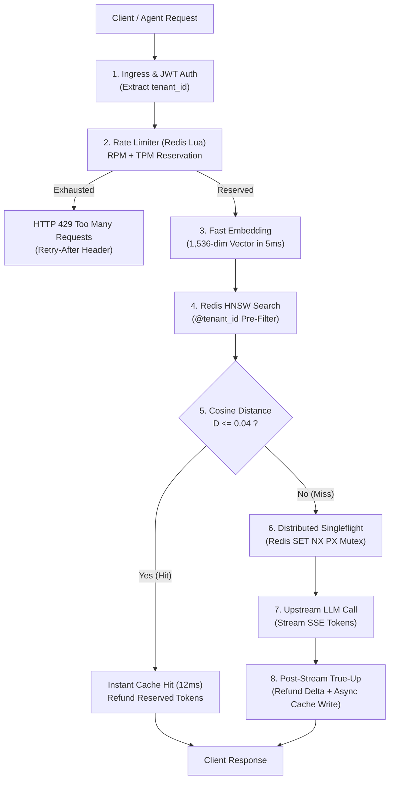

# Semantic Caching & Token Rate-Limiting for Production AI Gateways (.NET 10 & Redis)

This repository contains the full production architecture and 28-assertion verification test harness for the high-throughput AI Gateway built with **ASP.NET Core 10**, **YARP**, and **Redis Stack 7.2 (RediSearch HNSW)**.

---

## Architecture Overview



---

## Features

1. **Semantic Vector Caching:** Cosine distance nearest-neighbor search ($\varepsilon \le 0.04$) via RediSearch HNSW index, replacing broken SHA-256 string hashing.
2. **Two-Dimensional Rate Limiting (RPM + TPM):** Enforces both request count and token budgets with atomic two-phase reservations and accurate `Retry-After` calculation.
3. **Multi-Tenant Security:** Native RediSearch tag pre-filtering (`@tenant_id:{$tenant}`) preventing cross-tenant data leakage at the graph traversal level.
4. **Stampede Prevention:** Distributed Singleflight mutex coalescing duplicate in-flight requests into exactly 1 upstream call, plus XFetch probabilistic early refresh.
5. **28-Assertion Automated Verification Suite:** Testing negative failure modes, boundary conditions, and race conditions.

---

## Quickstart

### 1. Run the Automated 28-Assertion Verification Suite
To execute the automated self-test harness verifying all 28 architectural checks:

```bash
dotnet run --self-test
```

### 2. Start Redis Stack via Docker Compose
To launch local Redis Stack with RediSearch and RedisInsight:

```bash
docker compose up -d
```
Access RedisInsight UI at `http://localhost:8001`.

### 3. Run the AI Gateway
```bash
dotnet run
```
The gateway listens on `http://localhost:5000`.

---

## File Structure

- `Program.cs` - ASP.NET Core Web API setup, middleware pipeline, and `/v1/chat/completions` endpoint.
- `Filters/AiGatewayEndpointFilter.cs` - Core endpoint filter orchestrating auth, rate reservation, semantic cache lookup, and true-up.
- `Services/SemanticCacheService.cs` - Vector geometry, cosine distance computation, and RediSearch HNSW integration.
- `Services/TokenRateLimiter.cs` - Two-phase token bucket rate limiter (RPM + TPM).
- `Services/SingleflightService.cs` - Concurrency mutex preventing cache stampedes.
- `Services/XFetchService.cs` - Probabilistic early expiration algorithm (VLDB 2015).
- `GatewaySelfTests.cs` - Comprehensive 28-assertion test harness.
- `scripts/reserve_tokens.lua` - Atomic pre-flight token reservation Redis script.
- `scripts/trueup_tokens.lua` - Atomic post-stream true-up refund Redis script.
- `docker-compose.yml` - Redis Stack 7.2 container setup.
